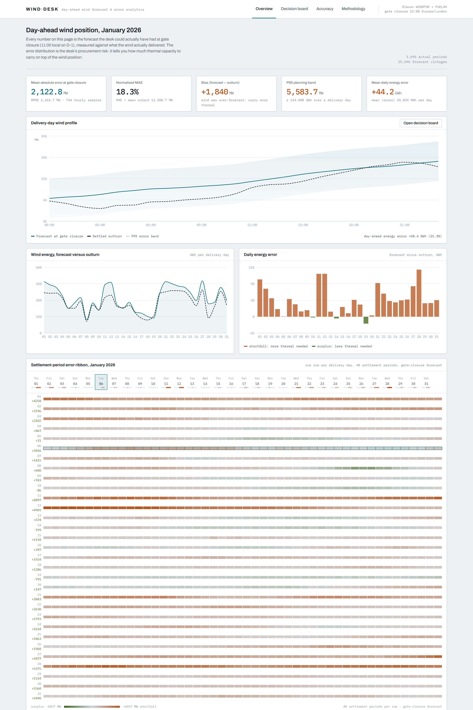
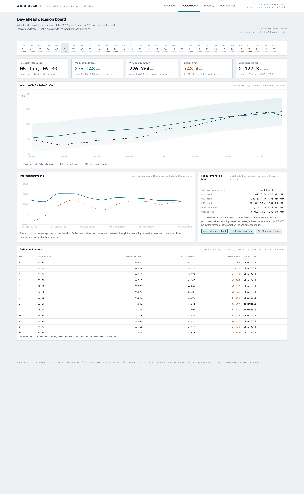
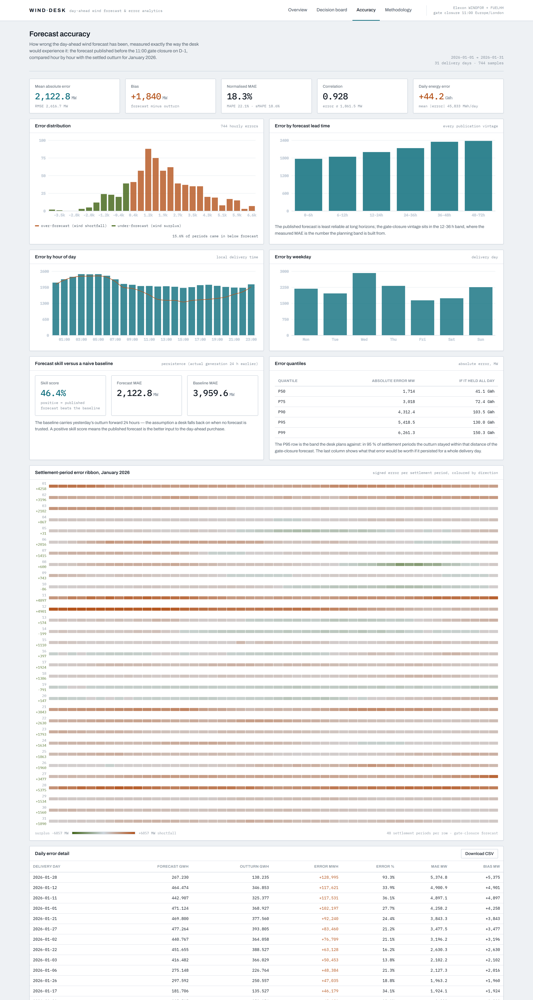
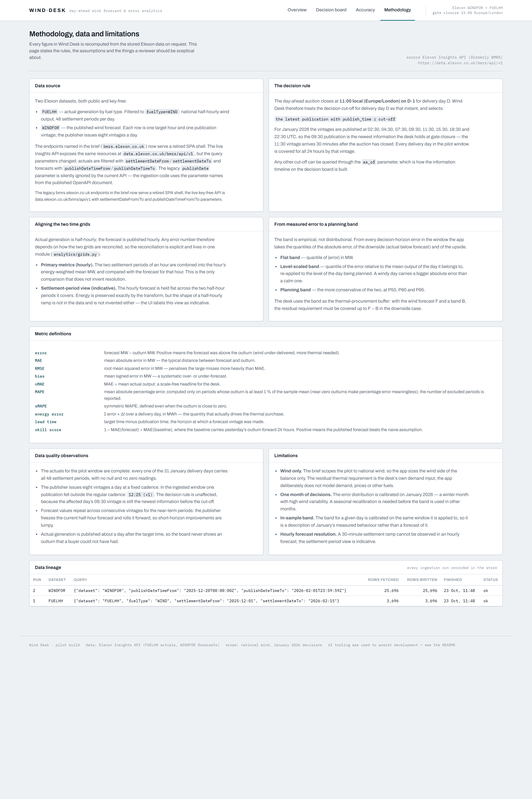

# Wind Desk — day-ahead wind forecast & accuracy portal

**Wind Desk** is a pilot web application for a UK energy utility's day-ahead power
purchasing desk. It answers the two questions the desk actually has on the morning of
**D‑1**, when the day-ahead auction for delivery day **D** closes:

1. _What is the latest wind forecast we can act on?_ — the forecast vintage published
   before gate closure (11:00 Europe/London on D‑1), not the latest forecast in the world.
2. _How wrong has that forecast been?_ — measured quantitatively, so the residual
   procurement requirement can be sized with a defensible buffer instead of a gut feel.

Everything is computed from national wind data published by Elexon: actual generation
(`FUELHH`, half-hourly) and published wind forecasts (`WINDFOR`, hourly vintages) for the
**January 2026** delivery days.

> **AI tooling disclosure (as requested in the brief).** This application was built with AI
> assistance: an LLM coding agent (Zed's agent runtime, MiniMax-M3.1-Flash) wrote the
> majority of the code, the tests and the documentation, and was used for domain research
> against the live Elexon API. The analysis methodology, the decision rule and every number
> in the UI are reproducible from the public data with the commands in this README — no
> figure is hard-coded.

---

## Contents

- [What it does](#what-it-does)
- [Screenshots](#screenshots)
- [Quick start](#quick-start)
- [Repository layout](#repository-layout)
- [API reference](#api-reference)
- [Methodology in one page](#methodology-in-one-page)
- [Data source and the API migration](#data-source-and-the-api-migration)
- [Deployment](#deployment)
- [Testing](#testing)
- [Demo video](#demo-video)
- [Limitations and next steps](#limitations-and-next-steps)

---

## What it does

| Capability                                                                                                                                                                                                                                   | Where                           |
| -------------------------------------------------------------------------------------------------------------------------------------------------------------------------------------------------------------------------------------------- | ------------------------------- |
| **Decision board** — the gate-closure forecast for a delivery day, the settled outturn, the signed error per settlement period, the information timeline of every publication that existed before the cut-off, and the procurement risk band | `Decision board` page           |
| **Accuracy analytics** — MAE, RMSE, bias, nMAE, MAPE/sMAPE, error quantiles, error vs lead time, error by hour of day and weekday, error distribution, skill score against a persistence baseline, CSV export                                | `Accuracy` page                 |
| **Error ribbon** — one row per delivery day, 48 settlement periods, coloured by signed error: the month at a glance                                                                                                                          | `Overview` and `Accuracy` pages |
| **Methodology & lineage** — decision rule, grid alignment, metric definitions, data-quality observations, limitations, and every ingestion run recorded                                                                                      | `Methodology` page              |
| **Reproducible data pipeline** — chunked pulls from the Elexon API with retries and backoff, idempotent upserts, and a provenance table                                                                                                      | `backend/app/data/`             |

### Headline result — January 2026 decisions (31 delivery days, 744 hourly samples)

| Metric                        | Value                        | Reading                                                               |
| ----------------------------- | ---------------------------- | --------------------------------------------------------------------- |
| MAE at gate closure           | **2,123 MW**                 | typical distance between forecast and outturn                         |
| RMSE                          | 2,617 MW                     | large misses are common enough to matter                              |
| Bias (forecast − outturn)     | **+1,840 MW**                | the published wind forecast is systematically **too high** in January |
| nMAE                          | 18.3 %                       | scale-free headline for the desk                                      |
| Correlation                   | 0.928                        | the shape of the day is well captured                                 |
| Mean daily energy error       | **+44.2 GWh**                | ~16 % more wind was promised than delivered                           |
| P95 planning band             | **±5,584 MW** (±134 GWh/day) | the buffer the desk should carry                                      |
| Downside P95                  | 1,146 MW (27.5 GWh/day)      | wind shortfall in the worst 5 % of periods                            |
| Skill vs persistence baseline | **+46.4 %**                  | the published forecast is far better than yesterday's outturn         |

The **bias** is the headline commercial finding: in January the gate-closure wind forecast
over-forecasts generation by roughly 1.8 GW on average. A desk that buys thermal purely to
cover the published wind forecast is systematically short, and the quantified band is what
turns that into a procurement decision.

---

## Screenshots

|                                                                                         |                                                                                                               |
| --------------------------------------------------------------------------------------- | ------------------------------------------------------------------------------------------------------------- |
|                                            |                                                      |
| Overview: position, headline error, daily energy error and the settlement-period ribbon | Decision board: the vintage used, the profile against the outturn, the information timeline and the risk band |
|                                            |                                                            |
| Accuracy: distribution, lead time, hour of day, weekday, skill score, quantiles         | Methodology: sources, decision rule, grid alignment, metric definitions, lineage                              |

---

## Quick start

### Option A — Docker (one command)

```bash
git clone <your-anonymous-repo-url>
cd <repo>
docker compose up --build
```

- Web app: <http://localhost:8080>
- API + interactive docs: <http://localhost:8000/api/docs>

The repository ships a **pre-seeded SQLite database** (`backend/data/wind.db`, built from
the live Elexon API), so the stack starts with January 2026 data already in it — no network
access needed to see the product.

To refresh the data from source:

```bash
docker compose run --rm ingest        # pulls FUELHH + WINDFOR and upserts the store
```

### Option B — local development

```bash
make install                          # python venv + npm install
make ingest                           # build backend/data/wind.db from the Elexon API
make dev-api                          # FastAPI on http://127.0.0.1:8000
make dev-web                          # Vite dev server on http://127.0.0.1:5173
```

`make dev-web` proxies `/api` to the FastAPI service, so the browser only ever talks to
one origin. Without `make`:

```bash
python -m venv .venv && .venv/Scripts/python -m pip install -r backend/requirements-dev.txt
cd backend && ../.venv/Scripts/python -m uvicorn app.main:app --reload
cd frontend && npm install && npm run dev
```

Requirements: Python ≥ 3.11, Node ≥ 20, Docker (for the containerised path).

---

## Repository layout

```
.
├── plan.md                     # the delivery plan this implementation follows
├── README.md                   # this file
├── Makefile                    # install / ingest / dev / test / docker commands
├── docker-compose.yml          # api + web services, plus a one-shot "ingest" service
├── Dockerfile                  # combined image (FastAPI + built SPA) for Heroku
├── vercel.json                 # Vercel build: static front-end + Python function
├── api/index.py                # Vercel serverless entrypoint (exposes the FastAPI app)
├── Procfile, heroku.yml        # Heroku container deployment
├── .env.example                # every configuration value, documented
│
├── backend/
│   ├── Dockerfile              # API image (python:3.12-slim)
│   ├── requirements.txt        # runtime dependencies
│   ├── requirements-dev.txt    # + pytest, ruff
│   ├── app/
│   │   ├── main.py             # FastAPI application, CORS, static SPA hosting
│   │   ├── config.py           # settings (gate closure, windows, paths) — all env driven
│   │   ├── db.py               # SQLAlchemy engine (SQLite by default, Postgres-ready)
│   │   ├── models.py           # actual_generation, wind_forecast, data_run
│   │   ├── service.py          # application service: snapshot + product views
│   │   ├── timeutils.py        # UTC / Europe-London / settlement-period conversions
│   │   ├── api/routes.py       # REST API under /api
│   │   ├── data/
│   │   │   ├── elexon.py       # HTTP client: retries, backoff, chunked windows
│   │   │   ├── ingest.py       # idempotent upserts + provenance records
│   │   │   └── repository.py   # read model used by the analytics
│   │   └── analytics/
│   │       ├── grids.py        # hourly ⇄ half-hourly alignment (the key modelling step)
│   │       ├── decision.py     # gate-closure vintage selection
│   │       ├── metrics.py      # MAE/RMSE/bias/nMAE/MAPE/quantiles/series/heatmap
│   │       └── bands.py        # empirical confidence bands
│   ├── scripts/seed.py         # CLI that builds the store from the Elexon API
│   ├── data/wind.db            # pre-seeded SQLite store (committed on purpose)
│   └── tests/                  # pytest: metrics, decision logic, grids, API smoke
│
├── frontend/
│   ├── Dockerfile              # multi-stage: Vite build → nginx (also proxies /api)
│   ├── nginx.conf              # static assets + /api proxy + SPA fallback
│   ├── src/
│   │   ├── App.tsx             # shell, navigation, routes
│   │   ├── styles.css          # design system (tokens, panels, tables, ribbon)
│   │   ├── api/                # typed client + response contracts
│   │   ├── components/         # WindProfileChart, ErrorRibbon, DayStrip, ui primitives
│   │   ├── hooks/              # selected-delivery-day (kept in the URL)
│   │   └── pages/              # Overview, DecisionBoard, Accuracy, Methodology
│   └── vite.config.ts
│
├── docs/
│   ├── methodology.md          # full metric definitions, assumptions, caveats
│   ├── screenshots/            # UI captures used in this README and the video
│   └── video/                  # demo video scripts, storyboard and build notes
│
├── tools/
│   ├── shots/                  # screenshot + headless smoke-check tooling
│   │   ├── shots.mjs           # captures the UI into docs/screenshots
│   │   ├── zoom.mjs            # captures the settlement-period detail table
│   │   └── check.mjs           # headless check: no console errors, no failed requests
│   └── video/                  # demo-video production pipeline (script → MP4)
│       ├── script.json         # the narration and the scene plan (single source of truth)
│       ├── tts.ps1             # Windows SAPI narration, no network needed
│       ├── cards.mjs           # renders the slides
│       ├── record.mjs          # records the app segments against the timeline
│       └── build.mjs           # assembles clips, audio, captions and the final MP4
```

---

## API reference

All responses use the envelope `{"data": ..., "meta": {"generated_at": ...}}`.

| Method | Path                                        | Purpose                                                               |
| ------ | ------------------------------------------- | --------------------------------------------------------------------- |
| GET    | `/api/health`                               | liveness and database check                                           |
| GET    | `/api/meta`                                 | data source, market rules, coverage, publication cadence              |
| GET    | `/api/data-runs`                            | ingestion provenance (every API call that produced the data)          |
| GET    | `/api/actuals?date_from&date_to`            | raw half-hourly actuals                                               |
| GET    | `/api/forecasts?delivery_date&publish_time` | raw forecast vintages                                                 |
| GET    | `/api/publishes`                            | every publication timestamp                                           |
| GET    | `/api/decision/{delivery_date}?as_of`       | **R1** — decision-time forecast, outturn, error, band, timeline       |
| GET    | `/api/accuracy/summary`                     | **R2** — headline error metrics and quantiles                         |
| GET    | `/api/accuracy/series`                      | daily metric series                                                   |
| GET    | `/api/accuracy/by-lead-time`                | error versus forecast horizon                                         |
| GET    | `/api/accuracy/by-hour`                     | error by delivery hour                                                |
| GET    | `/api/accuracy/by-weekday`                  | error by weekday                                                      |
| GET    | `/api/accuracy/distribution`                | error histogram and quantiles                                         |
| GET    | `/api/accuracy/heatmap`                     | delivery day × hour error matrix                                      |
| GET    | `/api/accuracy/ribbon`                      | per settlement-period errors for the error ribbon                     |
| GET    | `/api/accuracy/baselines`                   | persistence baseline and skill score                                  |
| GET    | `/api/accuracy/export.csv`                  | full error table as CSV                                               |
| POST   | `/api/admin/ingest`                         | re-ingest from source (token guarded; disabled without `ADMIN_TOKEN`) |

Interactive documentation: <http://localhost:8000/api/docs>.

---

## Methodology in one page

Full detail in [`docs/methodology.md`](docs/methodology.md).

**Decision rule.** The day-ahead auction closes at 11:00 local on D‑1. For delivery day D
the application selects _the latest publication with `publish_time ≤ cut-off`_. Elexon
publishes the wind forecast eight times a day (02:30, 04:30, 07:30, 09:30, 11:30, 15:30,
18:30, 22:30 UTC), so for a January decision the **09:30 vintage is the newest information
the desk holds** — the 11:30 vintage lands half an hour _after_ the auction has closed. Any
other cut-off can be requested with `?as_of=…`, which is how the information timeline is
built.

**Grid alignment.** Actuals are half-hourly; the forecast is published hourly. Primary error
metrics compare the forecast hour with the _energy-weighted mean_ of the two settlement
periods in that hour — the only comparison that does not invent resolution. The
settlement-period view holds the hourly forecast flat across the hour (step-hold), which
preserves energy exactly and is labelled _indicative_ in the UI.

**Error definition.** `error = forecast − outturn` (MW). Positive means wind was
over-forecast, i.e. the desk was short of renewable energy and needed more thermal.

**Confidence band.** Empirical, not assumed-Gaussian: quantiles of |error|, of the downside
(actual below forecast) and of the upside, computed over the decision-horizon sample, plus a
level-scaled variant (errors relative to the day's mean output). The planning band is the
more conservative of the two at P50/P80/P95.

**Reproducibility.** Every figure is recomputed from the database on request; no result is
hard-coded. `make ingest && make test` reproduces the numbers in this README from the
public API.

---

## Data source and the API migration

The brief points at `bmrs.elexon.co.uk/api-documentation/endpoint/datasets/…`. Those
endpoints have been **retired**: the host now serves a single-page shell. The live,
key-free **Elexon Insights API** exposes the same resources at
`https://data.elexon.co.uk/bmrs/api/v1` (spec:
`https://data.elexon.co.uk/swagger/v1/swagger.json`), and the NESO portal
(`api.neso.energy`) now requires a login.

Two traps were found and handled:

1. **Parameter names changed.** `FUELHH` is filtered with `fuelType` +
   `settlementDateFrom`/`settlementDateTo`; `WINDFOR` only offers
   `publishDateTimeFrom`/`publishDateTimeTo`. The legacy `publishDate` parameter is
   _silently ignored_ by the current API — a request that looks successful but returns the
   wrong window.
2. **The forecast has no target-time filter.** Forecasts must be filtered client-side by
   `startTime`, which is why the ingest pulls by publication window and the analytics
   select the target hours afterwards.

The client is in `backend/app/data/elexon.py`; the parameter choice is asserted by the
ingestion code and the API documentation page in the UI.

---

## Deployment

### Vercel (recommended)

```bash
npm i -g vercel
vercel link            # or: vercel --prod
vercel deploy --prod
```

`vercel.json` builds the front-end as a static site and the FastAPI app as a Python
function (`api/index.py`); `/api/*` routes to the function and everything else falls back
to the SPA shell. The SQLite store is bundled with the function and opened **read-only**
(`SQLITE_READONLY=1`), which is what a serverless filesystem allows. To refresh the data,
run `make ingest` locally and redeploy.

Live URL: **`<fill in after deploying>`**

### Heroku (alternative)

```bash
heroku create <your-app-name>
heroku stack:set container -a <your-app-name>
git push heroku main
```

`heroku.yml` builds the combined `Dockerfile` (FastAPI + the built single-page app served
from `STATIC_DIR`), so a single dyno serves both the API and the UI.

Live URL: **`<fill in after deploying>`**

### Docker anywhere

```bash
docker compose up --build      # web on :8080, api on :8000
```

---

## Testing

```bash
make test            # backend pytest suite + front-end type check and production build
make test-backend    # 33 tests: metrics maths, decision logic, grid alignment, API smoke
```

The suite covers the parts a reviewer should not have to take on trust:

- **Metric maths** against hand-computed fixtures (MAE, RMSE, bias, quantiles, MAPE
  near-zero guard, energy totals, lead-time bucketing).
- **Decision logic** at the boundaries: a publication exactly on the cut-off, a
  publication after the cut-off, incomplete coverage, and no publication at all.
- **Grid alignment**: hourly aggregation is energy weighted; step-hold preserves energy
  exactly (1 MW for 1 h == 1 MW across two settlement periods).
- **API smoke tests** against the seeded database: the selected vintage, daily aggregate
  consistency, window defaults, CSV export, and graceful handling of a day with no data.

There is also a headless end-to-end check of the built UI (it drives the locally
installed Edge via `playwright-core`, so no browser download is needed). It fails on any
console error, failed request or HTTP ≥ 400, and asserts that the charts, tables and
error ribbon actually rendered:

```bash
docker compose up --build -d
node tools/shots/check.mjs http://127.0.0.1:8080
```

```
ok   /
ok   /decision?day=2026-01-06
ok   /accuracy
ok   /methodology

all pages clean
```

---

## Demo video

The demo is **rendered from a script**, so it can be rebuilt after any change to the app:

```bash
docker compose up --build -d
npm --prefix tools/video install
node tools/video/build.mjs http://127.0.0.1:8080
```

- Scripts, narration and storyboard: [`docs/video/`](docs/video/)
- Part 1 — client pitch (4:17): the product, the problem, the January findings.
- Part 2 — technical review (4:59): architecture, data model, the grid-alignment and
  decision-rule decisions, testing and deployment.
- Full video: 9:16 — inside the brief's 5-minute-per-part and 10-minute-total limits.

The rendered MP4s are written to `tools/video/out/` and are not committed (67 MB);
regenerate them with the command above.

Upload it as an **unlisted** YouTube video and link it in the submission form:
**`<fill in after uploading>`**

---

## Limitations and next steps

Honest boundaries of the pilot, in the order they would matter to the client:

1. **Wind only.** The brief scopes the pilot to national wind, so the app sizes the wind
   side of the balance. The residual requirement is `demand − wind`, and demand is the
   desk's own input — the app deliberately does not model it.
2. **One month.** The band is calibrated on January 2026, a high-variability winter month.
   A seasonal recalibration is needed before it is used elsewhere.
3. **In-sample band.** The band for a day is calibrated on the window it is applied to, so
   it describes January's measured behaviour rather than predicting it. A rolling
   out-of-sample calibration (e.g. trailing 60 days) is the natural next step.
4. **Hourly forecast resolution.** A 30-minute ramp is not observable in an hourly
   forecast; the settlement-period view is indicative.
5. **Data-quality watch item.** In the ingested window one publication fell outside the
   regular 8-per-day cadence (15 Jan 12:25 UTC). The decision rule is unaffected, but the
   pipeline records every ingestion and the cadence is surfaced in the UI.

Natural extensions: other fuel types and interconnector positions, a live "today's
decision" mode, demand-side residual modelling, and an out-of-sample rolling calibration
service.
