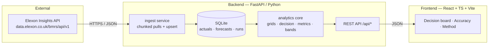

# Plan — "Wind Desk" · Day-Ahead Wind Forecast & Accuracy Portal

> Delivery plan for the *Full Stack SWE challenge v4* brief (`REint Full Stack SWE challenge v4 Shared.md`).
> Client: UK energy utility, day-ahead power purchase desk (GB).
> Stack: React (front-end) + Python (back-end) + Docker + Vercel (deploy).
> Budget: ≤ 16 hours.

---

## 1. Problem understanding

The client buys power in the **GB day-ahead market** to cover consumer demand. Anything not
covered by renewables (wind in scope here) must be bought from thermal plant. The day-ahead
auction has **gate closure at 11:00 on D‑1** for delivery day D, so the purchase decision is
made **~24 h before delivery**, using only the forecast information available at that moment.

Two product requirements follow directly:

| # | Requirement (from PM) | Product capability |
|---|---|---|
| R1 | "Clearly understand the **latest** renewable generation forecasts available when they need to make decisions" | A **decision board** that answers "what did we know at gate closure for delivery day D?" — not "what is the latest forecast now" |
| R2 | "**Evaluate the accuracy** of the renewable generation forecasts **quantitatively** … considering the quantified error" | An **accuracy analytics** module: error metrics, error distributions, error-vs-horizon, and an empirical **confidence band** that converts measured error into a procurement margin |

The bridge between R1 and R2 is the core insight of the product:
**the error distribution measured at decision horizon is the risk buffer the desk must carry
into its day-ahead purchase.** Measured error → quantified band → actionable buy margin.

## 2. Domain research (what I learned before designing)

Findings from the live Elexon/NESO APIs (verified empirically, not assumed):

1. **The URL in the brief (`bmrs.elexon.co.uk/api-documentation/...`) now serves an SPA shell —
   the legacy BMRS API was retired.** The live public API is the *Elexon Insights* API at
   `https://data.elexon.co.uk/bmrs/api/v1` (same `/datasets/FUELHH/stream` and
   `/datasets/WINDFOR/stream` paths, no API key required). The new NESO portal
   (`api.neso.energy`) requires a login, so it is not suitable for a self-contained demo.
   *The app is written against the live Insights API and documents the migration.*
2. **Real query parameters** (from the published OpenAPI spec at
   `https://data.elexon.co.uk/swagger/v1/swagger.json`):
   * `FUELHH`: `fuelType[]`, `settlementDateFrom`, `settlementDateTo`, `settlementPeriod[]`
   * `WINDFOR`: `publishDateTimeFrom`, `publishDateTimeTo` (there is **no** target-time filter —
     forecasts must be filtered client-side)
   The parameter names in the brief's legacy docs (`publishDate`) are silently ignored by the
   current API — a classic trap; our client filters on the real names.
3. **Grid mismatch (the most important modelling decision):**
   * `FUELHH` actuals are **half-hourly** (48 settlement periods/day, 30 min).
   * `WINDFOR` forecasts are **hourly** (73 target hours per publish, covering ~3 days ahead).
   Any error metric therefore needs an explicit, documented grid-alignment step (§6.1).
4. **Forecast publication cadence:** 8 publishes/day at **02:30, 04:30, 07:30, 09:30, 11:30,
   15:30, 18:30, 22:30 UTC**. At 11:00 gate closure the **latest available publish is 09:30**;
   the 11:30 publish arrives 30 minutes *after* the auction closes. That is exactly the
   "latest information available at decision time" the brief asks for.
5. **Actuals are published ~1 day after the target time** (SP 48 of D is published at 00:00 on
   D+1), so a live board never leaks the actual before the decision — retrospection is only
   possible in the analytics module, which is how the pilot is framed.
6. **Data quality (Jan 2026):** 1488/1488 half-hours present, no nulls, no zeros, no duplicate
   settlement periods. Mean 11.58 GW, max 17.81 GW, min 1.70 GW.
7. **Day-ahead gate closure = 11:00 local (Europe/London) on D‑1** (NESO SDW auction). In
   January, London = UTC; the app nevertheless uses a timezone-aware rule so it stays correct
   in BST months.

## 3. Scope decisions

* **In scope:** national wind (fuelType `WIND`) actuals and wind forecasts, Jan 2026 delivery
  days, decision-time forecast selection, quantitative error analysis, confidence bands.
* **Out of scope (explicit, per brief: "no other data beyond this"):** demand, prices, other
  fuel types, interconnector flows. Consequence: the app sizes the **wind side** of the
  balance and expresses the residual requirement as *"wind is X ± Y MWh"*, which the desk
  converts into its thermal purchase. The UI states this plainly rather than inventing demand.
* **Reference window:** actuals 2025‑12‑01 → 2026‑02‑15 (Jan 2026 evaluation + 4 weeks of
  look-back for the persistence baseline + Feb context); forecast publishes 2025‑12‑20 →
  2026‑02‑01 (covers every Jan-2026 decision window plus up to ~10 days of lead time).
* **Decision rule (configurable, `GATE_CLOSURE_TIME`, default 11:00 Europe/London):** for
  delivery day D, the desk takes the **latest WINDFOR publish with `publish_time ≤ cutoff`**
  where cutoff = gate closure on D‑1. Arbitrary "as-of" cut-offs are supported for what-if work.

## 4. Product definition (user stories)

**Buyer (day-ahead trader)**
- US-1: "For delivery day D, show me the wind profile I would have had at gate closure."
- US-2: "Show the error band around that profile so I know how much thermal to cover."
- US-3: "How did the forecast for D evolve through D‑1? (information timeline)"
- US-4: "Give me the settled error for D so I can check the desk's risk assumption."
- US-5: "Is the forecast getting better or worse? By hour of day? By lead time?"

**Risk / analytics (tech lead)**
- US-6: "Show MAE, RMSE, bias, nMAE, MAPE, error quantiles over January."
- US-7: "Show the error distribution and the daily error ribbon for all 31 days."
- US-8: "Compare against a naive persistence baseline (skill score)."
- US-9: "Show data lineage: which API, which query, when ingested, how many rows."

**Data ops**
- US-10: "Re-ingest from source on demand; see provenance of every row."

## 5. Architecture



**Why this shape**

* **SQLite, not Postgres.** The dataset for the pilot is ~30 k rows. SQLite keeps the whole
  app runnable with `docker compose up` (no external service), makes the demo reproducible
  offline, and lets the *same* pre-built database file be shipped inside the Vercel function
  bundle. Swap-in ready for Postgres via `DATABASE_URL` (SQLAlchemy layer is URL-driven).
* **Pre-built DB committed to the repo.** Reviewers get data without waiting on the upstream
  API; the ingestion path is still live and re-runnable (`make ingest`).
* **Analytics as a pure, testable core.** `backend/app/analytics/*` has no I/O beyond a
  DataFrame of loaded rows → unit-testable metric maths (the part a technical lead will read
  most carefully).
* **Reproducibility/lineage.** Every ingest writes a `data_runs` row: dataset, query
  parameters, row count, checksum, timestamp → surfaced in the UI's *Data lineage* panel.

### Repo layout

```
.
├── plan.md                     ← this document
├── README.md                   ← deliverables: layout, how to run, live link, AI-tools note
├── docker-compose.yml          ← one-command local run (api + web)
├── Makefile                    ← ingest / test / build / dev helpers
├── vercel.json, api/index.py   ← Vercel deployment (frontend static + FastAPI function)
├── Procfile, app.json          ← Heroku alternative
├── backend/
│   ├── Dockerfile, requirements.txt, pyproject.toml
│   ├── app/
│   │   ├── main.py             ← FastAPI app, CORS, static, routers
│   │   ├── config.py           ← settings (gate closure, windows, paths)
│   │   ├── db.py, models.py    ← SQLAlchemy engine + schema
│   │   ├── schemas.py          ← Pydantic response contracts
│   │   ├── data/elexon.py      ← HTTP client (retry/backoff/chunking)
│   │   ├── data/ingest.py      ← idempotent upserts + provenance
│   │   └── analytics/          ← grids.py decision.py metrics.py bands.py
│   ├── scripts/seed.py         ← CLI: build/refresh the database
│   ├── data/wind.db            ← pre-built SQLite (committed)
│   └── tests/                  ← pytest: metrics, decision logic, API smoke
├── frontend/
│   ├── Dockerfile, nginx.conf  ← multi-stage build → nginx (proxies /api)
│   └── src/                    ← React app (pages, components, api client)
└── docs/
    ├── methodology.md          ← metric definitions, assumptions, caveats
    └── video/                  ← part 1 & 2 scripts + storyboard
```

## 6. Analytics methodology (the part that must be defensible)

### 6.1 Grid alignment (explicit, single place: `analytics/grids.py`)

| Quantity | Native grid | Aligned to | Rule |
|---|---|---|---|
| Actual wind generation | half-hourly (MW) | hourly (MW) | hourly MW = mean of the two SPs = MWh over that hour |
| Forecast wind generation | hourly (MW) | half-hourly (MW) | **step-hold**: hourly value applies to both SPs of the hour |

*Primary error metrics are computed on the native hourly grid* (forecast hour vs hourly-mean
actual) — this is the only comparison that does not invent resolution. Energy metrics
(MWh/GWh) are grid-invariant: step-hold preserves the hourly total exactly.
The half-hourly step-hold view is provided for settlement-period sizing and is labelled
*indicative* in the UI (a forecast published hourly cannot resolve a 30-minute ramp).

### 6.2 Decision-time selection (`analytics/decision.py`)

For delivery day D and cut-off `t`:
`publish* = max{ p : p.publish_time ≤ t and p covers D }`; the selected publish is reported
with its coverage (all 24 hours of D present → "full coverage"), and the whole publish
ladder (every publish ≤ t with its error) forms the *information timeline*.
Cut-off default = gate closure 11:00 Europe/London on D‑1.

### 6.3 Error metrics (`analytics/metrics.py`)

Per settlement period / hour: `e = forecast − actual` (MW).
* **Bias** = mean(e) — systematic over/under-forecast (MW).
* **MAE**, **RMSE**, **MAPE** (guarded: periods with actual < 1 % of mean actual are excluded
  from MAPE and reported as `mape_excluded`), **sMAPE** (defined for near-zero actuals).
* **nMAE** = MAE / mean(actual) — scale-free headline number for the desk.
* **Error quantiles** of |e|: P50, P75, P90, P95, P99, max → the confidence band.
* **Daily energy error**: Σ|e|·Δt per delivery day (MWh) and **daily bias** (MWh) →
  the quantity that actually drives the thermal purchase.
* **By lead time**: horizon = target_time − publish_time bucketed
  (≤6 h, 6–12 h, 12–24 h, 24–36 h, 36–48 h, >48 h) → "how much does the forecast decay?".
* **By hour of day** (delivery-time) → systematic shape in the error.
* **By weekday**, **by delivery day** → daily series.
* **Baseline & skill**: persistence (actual of the same clock half-hour 24 h earlier) as the
  naive reference; skill score = 1 − MAE_forecast/MAE_baseline (positive = forecast beats it).

### 6.4 Confidence band → procurement margin (`analytics/bands.py`)

From the January decision-horizon error sample (empirical, not assumed-Gaussian):
* **Central band** = forecast ± q(|e|) for q ∈ {P50, P80, P95} → MW band per SP.
* **Energy band** for the delivery day = Σ q(|e|)·Δt → MWh/GWh band.
* **Thermal cover**: the desk's residual requirement is *demand − wind*. With the wind
  forecast F and its band, the thermal buy must cover `demand − (F − band)` in the
  downside case. The app shows `wind risk band (GWh)` and states that the demand side is the
  desk's own input (out of scope per brief).

### 6.5 Guardrails
* Every metric endpoint states its sample size `n` and coverage.
* No interpolation is used to create forecast resolution; missing hours are reported as gaps.
* Numbers are recomputed from the database on request (no hard-coded results) → the analytics
  are reproducible by the reviewer.

## 7. API contract (v1)

| Method | Path | Purpose |
|---|---|---|
| GET | `/api/health` | liveness + DB check |
| GET | `/api/meta` | coverage windows, gate-closure config, source, last ingest |
| GET | `/api/data-runs` | provenance / lineage list |
| GET | `/api/actuals?date_from&date_to` | half-hourly actuals |
| GET | `/api/forecasts?target_date&publish_time` | raw forecast series |
| GET | `/api/decision/{delivery_date}?as_of` | **R1**: decision-time forecast + actual + error + band + coverage + timeline |
| GET | `/api/accuracy/summary?from&to` | **R2**: headline metrics + quantiles + n |
| GET | `/api/accuracy/series?from&to` | daily metric series |
| GET | `/api/accuracy/by-lead-time` | error vs horizon |
| GET | `/api/accuracy/by-hour` | error by delivery hour |
| GET | `/api/accuracy/by-weekday` | error by weekday |
| GET | `/api/accuracy/distribution` | error histogram + quantiles |
| GET | `/api/accuracy/heatmap` | delivery day × hour error matrix |
| GET | `/api/accuracy/baselines` | persistence baseline + skill scores |
| GET | `/api/accuracy/export.csv` | full error table (CSV) |
| POST | `/api/admin/ingest` | re-ingest (token-guarded) |

Responses are JSON with `{data, meta:{n, generated_at, ...}}` envelopes; all timestamps are
ISO-8601 UTC.

## 8. Front-end design direction

Subject: a day-ahead trading desk; content: settlement-period curves, error ribbons, quantiles.
The interface should feel like an **operations chart**, not a SaaS card kit.

* **Ground:** cool chart paper `#EEF1F4`, surfaces `#FFFFFF`, ink `#101822`, rules `#C9D2DC`.
* **Signals (semantic, two-colour divergence):** forecast = maritime teal `#0E6E7D`;
  actual = graphite-ink line; shortfall (wind below forecast → more thermal needed) =
  rust `#B4531B`; surplus = pine `#3F6212`. Confidence band = teal wash, rust edge for downside.
* **Type:** `Archivo` (industrial grotesk, tight tracking) for headings/UI; `IBM Plex Mono`
  (tabular numerals) for every number — numbers are the product, so they get a real typeface.
  Loaded from Google Fonts with a system fallback stack.
* **Layout:** left-aligned, dense numeric tables with hairline rules, no rounded-card soup;
  tabular-nums everywhere; a persistent **delivery-day context strip** so the trader never
  loses which day they are looking at.
* **Signature element:** the **error ribbon** — a 31-row × 48-cell diverging strip of signed
  error per settlement period across January, scannable in one glance, with a legend. It is
  the visual embodiment of "quantified error" and does not exist in generic dashboards.
* **Hero:** the live delivery-day wind profile (gate-closure forecast vs settled actual vs
  band) rather than a big number.
* Restraint: one accent moment (the ribbon + band), quiet everywhere else; accessible
  contrast, keyboard focus, `prefers-reduced-motion` respected.

## 9. Engineering practices

* **Type hints everywhere**, `ruff`-clean, `mypy`-friendly layering (domain → schemas → api).
* **Tests:** pytest unit tests for metric maths (MAE/RMSE/quantiles/bands against
  hand-computed fixtures), decision-selection logic (boundary cases: publish exactly at
  cut-off, coverage gaps), and API smoke tests against the seeded DB. Frontend: type-check
  (`tsc --noEmit`) + production build as the gate.
* **Idempotent ingestion** (upsert on natural keys), retries with exponential backoff, and
  chunked date windows so a 12-month pull never exceeds API response limits.
* **Config via env vars** (`GATE_CLOSURE_TIME`, `DATABASE_URL`, `WINDOW_*`), 12-factor style so
  the same image runs locally and on Vercel.
* **Deterministic analytics**: no randomness; every figure traceable to a query.

## 10. Execution order (≈ budgeted hours)

| # | Step | Est. |
|---|---|---|
| 1 | Domain/API research (done above) | 1.5 h |
| 2 | Backend core: models, Elexon client, ingestion, seeding the DB | 2.5 h |
| 3 | Analytics core: grids, decision selection, metrics, bands | 2.5 h |
| 4 | FastAPI API layer + tests | 1.5 h |
| 5 | Front-end: shell, decision board, accuracy pages, styling | 4 h |
| 6 | Docker, docker-compose, Vercel/Heroku config, README | 1.5 h |
| 7 | Tests, polish, screenshots, video scripts + storyboard | 1.5 h |
| | **Total** | **≈15 h** |

## 11. Deliverables checklist

- [ ] `plan.md` (this file) and `README.md` (layout, how to run, live link, AI-tools disclosure).
- [ ] Dockerised app: `docker compose up` → web + API.
- [ ] Front-end (React) + back-end (Python/FastAPI) with the two required capabilities.
- [ ] Vercel deployment config + deployed URL (user's account) — Heroku fallback (`Procfile`).
- [ ] Automated tests (pytest) + type-checked front-end build.
- [ ] `docs/methodology.md` — metric definitions, assumptions, caveats.
- [ ] `docs/video/` — Part 1 (client pitch ≤5 min) and Part 2 (tech review ≤5 min) scripts,
      scene list and narration; rendered demo video where the environment allows.
- [ ] Submission form links — to be completed by the user (YouTube upload + repo + live URL
      require their accounts).

## 12. Risks & mitigations

| Risk | Mitigation |
|---|---|
| Legacy BMRS URL dead (already true) | Client targets the live Insights API; README documents the migration; data is pre-seeded so the demo never depends on upstream availability |
| Forecast hourly vs actuals half-hourly | Explicit alignment layer, documented, with native-grid primary metrics |
| Publish at exactly the cut-off boundary | `≤` semantics defined in one place (`decision.py`) and unit-tested |
| Upstream API rate limits during bulk ingest | Chunked windows, backoff, retry, and a committed pre-built DB |
| Vercel serverless has no writable FS | DB opened read-only from the bundled file; ingestion stays a separate CLI/CI job |
| Scope creep beyond wind | README/UI state the boundary explicitly and show how other fuels plug in |
